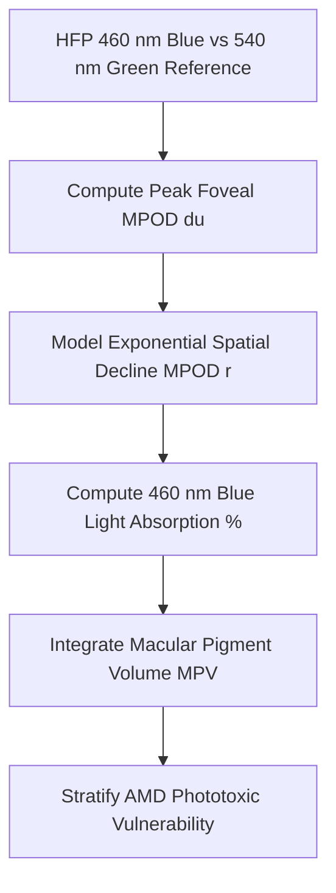

# Ocular Macular Pigment Optical Density (MPOD) Personal Agent Skill

[](LICENSE)
[](https://www.python.org/)
[]()
[]()
[]()

Deterministic, zero-mock personal agent micro-skill for calculating Foveal Center Macular Pigment Optical Density (MPOD in du), Spatial Profile Decay, Macular Pigment Volume (MPV), and AMD photoprotection level using heterochromatic flicker photometry principles.

## Architecture



## Quickstart

```python
from client import MacularPigmentOpticalDensityClient

client = MacularPigmentOpticalDensityClient()
result = client.evaluate_mpod(
    foveal_peak_mpod_du=0.62,
    profile_decay_constant=0.85
)
print(result)
```

## License

Apache-2.0
